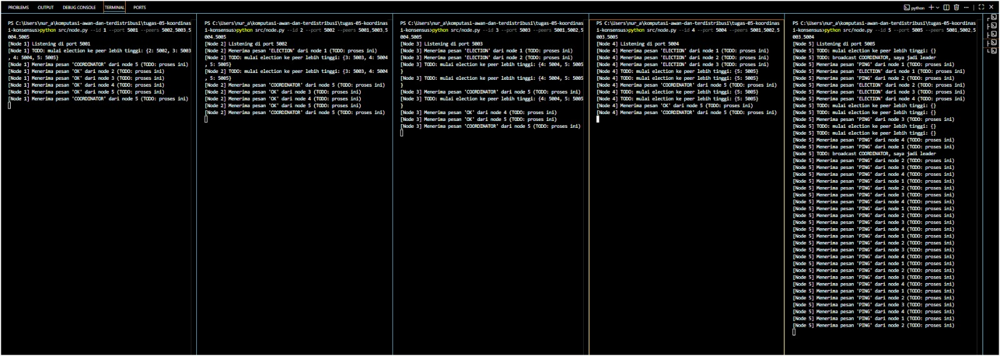
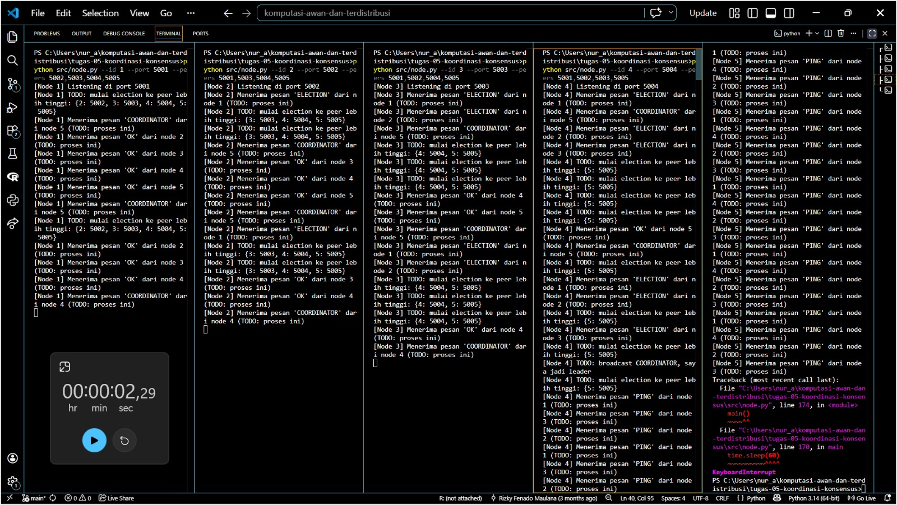

# Tugas 5 (Pekan 5) — Koordinasi & Konsensus

**Materi terkait:** Physical/Logical Clock, Election Algorithm (Bully/Raft).

## Studi Kasus

Terjadi konflik urutan waktu pada pesanan FoodGo (dua server mencatat urutan pesanan berbeda karena jam tidak sinkron), dan sistem membutuhkan satu **"Node Leader"** untuk mengelola antrean pesanan pusat agar tidak terjadi konflik pemrosesan ganda.

## Tugas Kelompok

Implementasikan simulasi **Bully Algorithm** untuk memilih leader di antara **5 node virtual** yang berjalan sebagai 5 proses Python terpisah di laptop yang sama (tiap node = satu proses di port berbeda, komunikasi lewat TCP socket di `localhost`).

Skeleton yang disediakan (`src/node.py`) sudah menangani bagian **infrastruktur jaringan** (membuka socket, menerima & mengirim pesan antar node) — bagian **algoritma Bully sendiri sengaja dikosongkan** (`# TODO`), karena itu inti pembelajaran tugas ini.

### Aturan Bully Algorithm yang harus diimplementasikan

1. Node yang mendeteksi leader tidak merespons (atau saat start pertama kali) mengirim pesan `ELECTION` ke semua node dengan ID **lebih besar** darinya.
2. Jika ada node ber-ID lebih besar yang merespons `OK`, node yang memulai election **berhenti mencalonkan diri** dan menunggu pesan `COORDINATOR`.
3. Jika **tidak ada** node ber-ID lebih besar yang merespons dalam batas waktu tertentu, node tersebut menjadi leader dan mem-broadcast `COORDINATOR` ke semua node lain.
4. Semua node mencatat siapa leader saat ini.

### Cara Menjalankan

Buka 5 terminal terpisah (satu per node):
```bash
python3 src/node.py --id 1 --port 5001 --peers 5002,5003,5004,5005
python3 src/node.py --id 2 --port 5002 --peers 5001,5003,5004,5005
python3 src/node.py --id 3 --port 5003 --peers 5001,5002,5004,5005
python3 src/node.py --id 4 --port 5004 --peers 5001,5002,5003,5005
python3 src/node.py --id 5 --port 5005 --peers 5001,5002,5003,5004
```

### Skenario Wajib Diuji & Dicatat

1. **Start normal**: nyalakan node 1–5 hampir bersamaan, catat siapa yang terpilih jadi leader (harusnya node ber-ID tertinggi, yaitu node 5).
2. **Leader mati**: matikan (Ctrl+C) proses node leader (node 5), amati node lain mendeteksi leader hilang dan memicu election baru. Catat leader baru yang terpilih (harusnya node 4).
3. Simpan log terminal (screenshot atau `> log_nodeX.txt` redirect) dari kedua skenario ke folder `bukti/`.

### JAWABAN KELOMPOK
1. Mengapa Perlu Leader?
Sistem FoodGo membutuhkan leader karena setiap server bisa memiliki waktu yang berbeda, sehingga urutan pesanan yang tercatat bisa tidak sama. Kondisi tersebut dapat menyebabkan konflik urutan dan pesanan diproses lebih dari satu kali. Dengan adanya leader, koordinasi antarserver dapat dilakukan dengan lebih teratur. Jika leader mati, node lain dapat memilih leader baru agar koordinasi sistem tetap berjalan.

2. Analisis Mengapa Menggunakan Trade-off Bully Dibandingkan Raft?
Bully Algorithm dipilih karena cara kerjanya sederhana dan mudah diterapkan pada lima node yang berjalan sebagai proses Python terpisah. Algoritma ini menentukan leader berdasarkan ID node, sehingga node dengan ID tertinggi yang masih aktif akan menjadi leader. Proses pemilihan dimulai ketika sebuah node baru dijalankan atau mendeteksi bahwa leader tidak merespons. Setelah itu, node tersebut mengirim pesan ELECTION kepada node dengan ID lebih tinggi. Jika ada node yang merespons dengan pesan OK, proses pemilihan akan dilanjutkan oleh node dengan ID lebih tinggi tersebut. Namun, jika tidak ada node dengan ID lebih tinggi yang merespons dalam batas waktu tertentu, node yang memulai pemilihan akan menjadi leader dan mengirim pesan COORDINATOR kepada node lainnya.

Sementara itu, Raft memiliki mekanisme yang lebih kompleks karena menggunakan masa pemilihan (term), komunikasi antarnode, dan kesepakatan mayoritas untuk memilih leader serta menjaga konsistensi data. Oleh karena itu, Bully Algorithm lebih cocok untuk simulasi pada tugas ini karena lebih mudah dipahami dan diterapkan. Meskipun begitu, Raft memiliki mekanisme konsensus yang lebih lengkap untuk menjaga konsistensi data dalam sistem terdistribusi.

3. Analisis Hasil Pengujian
Skenario 1: Start Normal



Skenario 2: Leader Mati



## Struktur Submission

```
tugas-05-koordinasi-konsensus/
├── README.md      # Analisis: kenapa perlu leader, kenapa Bully (vs Raft), hasil 2 skenario
├── JURNAL.md
├── src/
│   └── node.py
└── bukti/          # Log/screenshot skenario start normal & leader mati
```

## Rubrik Penilaian (Tugas 5)

| Komponen | Bobot | Kriteria |
|---|---|---|
| Implementasi Bully Algorithm benar | 35% | Election, OK, COORDINATOR message bekerja sesuai aturan algoritma |
| Bukti skenario leader mati → re-election | 30% | Log jelas menunjukkan leader baru terpilih otomatis |
| Analisis (kenapa perlu leader, trade-off Bully vs Raft) | 20% | Dikaitkan ke masalah urutan pesanan di skenario FoodGo |
| Proses & kontribusi kelompok | 15% | `JURNAL.md`, commit history |

## Batasan Penggunaan AI (Level 2)

Kebijakan **Level 2 (AI Assisted Idea Generation & Structuring)** berlaku — lihat [`../RUBRIK-UMUM.md`](../RUBRIK-UMUM.md). Boleh bertanya ke AI tentang gambaran umum algoritma election; **tidak boleh** meminta AI menuliskan isi `# TODO` di `src/node.py` (logika `on_message`, `start_election`, `declare_leader`, `monitor_leader`). Catat pemakaian AI di "Log Penggunaan AI" pada `JURNAL.md`.

- `README.md` wajib menjelaskan kenapa Bully Algorithm selalu memilih node ber-ID tertinggi yang masih hidup, dan apa kelemahannya dibanding algoritma lain (mis. jumlah pesan yang dikirim saat election, single point of failure sebelum leader baru terpilih) — bukan sekadar definisi generik.
