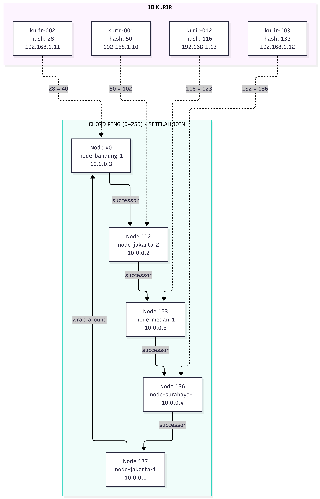
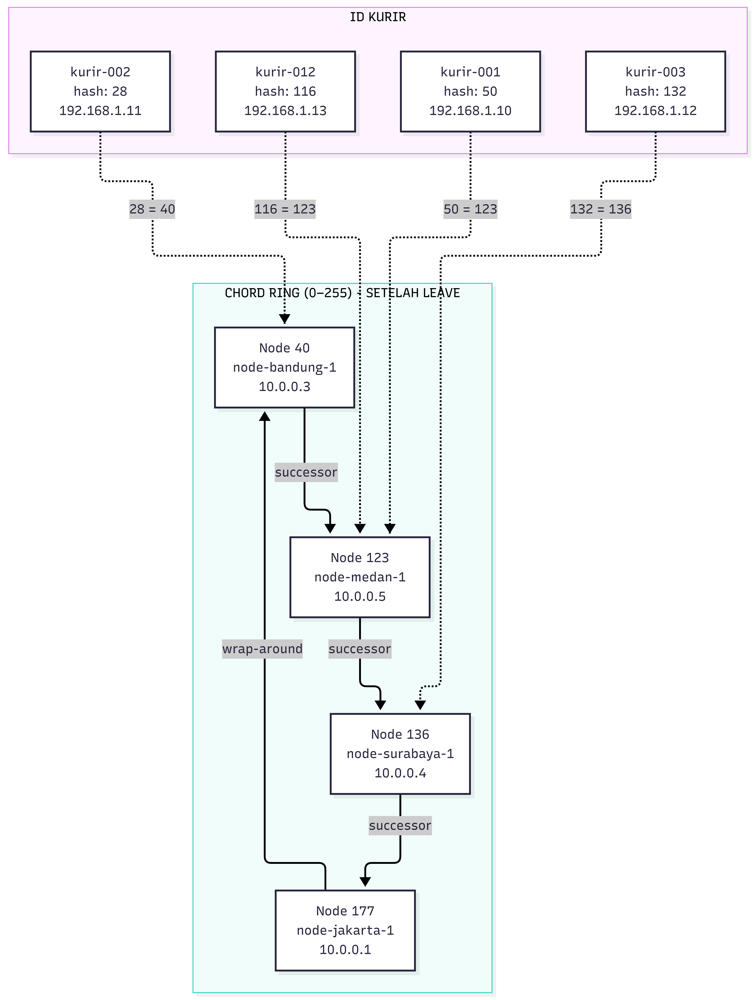
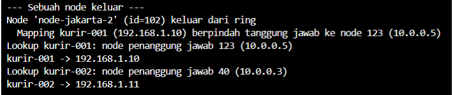

# Tugas 6 (Pekan 6) — Penamaan & Resolusi Lokasi

**Materi terkait:** Flat Naming, Structured Naming (DNS), Distributed Hash Table (DHT)/Chord.

## Studi Kasus

Pelanggan FoodGo kesulitan menemukan alamat IP server kurir yang **dinamis** (kurir berpindah lokasi/jaringan, IP-nya sering berubah). FoodGo butuh cara memetakan **ID Kurir** (identitas tetap) ke **alamat IP terkininya** tanpa server pusat tunggal yang jadi bottleneck/single point of failure.

## Tugas Kelompok

Implementasikan **simulasi Chord DHT** sederhana (single-process, tidak perlu jaringan sungguhan — cukup simulasi struktur data & algoritma di satu program Python) yang memetakan ID Kurir ke alamat IP mereka.

Konsep yang harus terlihat jalan dalam simulasi kalian:
1. **Consistent hashing**: ID Kurir dan ID Node di-hash ke ruang angka yang sama (mis. 0–255 untuk kesederhanaan, `m=8` bit).
2. **Ring topology**: node-node diurutkan melingkar berdasarkan hasil hash-nya.
3. **Lookup**: fungsi `lookup(kurir_id)` yang menemukan node mana yang bertanggung jawab menyimpan mapping ID Kurir tersebut → alamat IP-nya (aturan Chord: node dengan ID hash **terkecil yang lebih besar atau sama dengan** hash key, disebut *successor*).
4. **Perubahan topologi**: simulasikan minimal satu node baru bergabung (`join`) atau satu node keluar (`leave`), tunjukkan bagaimana mapping berpindah tanggung jawab ke node lain.

Skeleton disediakan di `src/chord_simulation.py` dengan fungsi hashing dan struktur ring sudah ada — bagian `lookup()`, `join()`, dan `leave()` sengaja dikosongkan.

### Cara Menjalankan

```bash
python3 src/chord_simulation.py
```

## Tugas Analisis (`README.md`)

1. Jelaskan **kenapa DHT/Chord** lebih cocok untuk kasus ini dibanding **flat naming sederhana** (mis. tabel pusat ID→IP) atau **DNS konvensional** — kaitkan dengan sifat "IP kurir sering berubah" dan kebutuhan tanpa titik gagal tunggal.
2. Gambarkan (boleh pakai Mermaid, lihat Tugas 2) ring topology dari simulasi kalian, tandai node mana yang bertanggung jawab atas ID Kurir mana.
3. Jelaskan apa yang terjadi pada mapping saat sebuah node **keluar** dari ring (siapa yang mengambil alih tanggung jawabnya) — dukung dengan output program.

## Jawaban analisis Kelompok
1. Analisis pemilihan DHT/CHORD dibandingkan flat naming dan DNS konversional
Pada studi kasus FoodGo, setiap kurir memiliki ID unik yang di gunakan sebagai identitas untuk melakukan pencarian alamat IP. Permasalahan ini muncul karena alamat IP kurir dapat berubah sewaktu-waktu akibat perpindahan jaringan atau pergantian koneksi internet. Oleh karena itu, FoodGo membutuhkan mekanisme penamaan dan pencarian lokasi yang mampu mengelola perubahan IP seara dinamis serta mengurangi ketergantungan terhadap satu server pusat.
Terdapat 3 pendekatan yang dapat digunakan, yaitu:
    
    a. Flat Naming Sederhana (tabel pusat ID -> IP)
        
        Flat naming sederhana menggunakan sebuah table pusat yang menyimpan pasangan ID kurir dan alamat IP. Ketika sistem ingin mencari lokasi kurir, sistem akan melakukan pencarian berdasarkan ID kurir pada table tersebut untuk memperoleh alamat IP yang terdaftar.
        pendekatan ini mudah diterapkan dan memiliki proses pencarian yang sederhana. Namun, ketika alamat IP kurir berubah, data pada table pusat harus diperbaharui agar sistem tidak menggunakan alamat IP yang sudah tidak berlaku. Selain itu, seluruh proses pencarian bergantung pada ketersediaan server pusat. Jika server tersebut mengalami kerusakan atau tidak dapat diakses maka proses pencarian alamat IP seluruh kurir dapat terganggu. Kondisi ini disebut Single Point of Failure (SPOF).
   
    b. DNS Konvensional
        
        DNS (Domain Name System) merupakan sistem yang digunakan untuk menerjemahkan nama domain menjadi alamat IP. DNS memiliki mekanisme pembaruan record dan caching yang membantu proses resolusi nama.
        Meskipun DNS dapat menangani perubahan alamat IP melalui perubahan record, perubahan tersebut tidak selalu langsung dapat diketahui oleh seluruh pengguna karena adanya mekanisme caching dan TTL (Time to Live). Selain itu, DNS dirancang terutama untuk resolusi nama domain melalui struktur hierarkis, bukan untuk mendistribusikan mapping ID kurir ke node aplikasi dalam suatu jaringan terdistribusi.
        Dengan demikian, DNS dapat digunakan untuk resolusi nama, tetapi kurang sesuai sebagai mekanisme utama pengelolaan lokasi kurir yang membutuhkan pembaruan mapping secara langsung pada node penanggung jawab.
    
    c. Distributed Hash Table (DHT) menggunakan Chord
        
        DHT dengan algotirma Chord merupakan pendekatan yang lebih sesuai untuk kasus FoodGo karena penyimpanan mapping ID kurir dan alamat IP didistribusikan ke beberapa node dalam jaringan, bukan hanya disimpan pada satu server pusat.
        Chord menggunakan consistent hashing untuk memetakan ID Node dana ID Kurir ke dalam ruangan identifier yang sama. Setiap ID Kurir akan ditetapkan pada node successor, yaitu node dengan nilai hash terkecil dalam ring.
        Ketika alamat IP kurir berubah, sistem dapat memperbaruimapping ID Kurir dengan alamat IP terbaru pada node yang bertanggunga jawab. ID Kurir tetap digunakan sebagai identitas sehingga perubahan alamat IP tidak mengharuskan sistem mengganti identitas kurir.
        Selain itu, Chord mendukung mekanisme node join dan leave. Ketika node baru bergabung atau node lama keluar, tanggung jawab penyimpanan mapping dapat dialihkan kepada node lain berdasarkan aturan succesor. Dengan demikian, hanya data yang terdampak perubahan topologi yang perlu dipindahkan.

2. Diagram 1: Sebelum Join
.png)
Pada diagram pertama, ring terdiri dari empat node, yaitu node 40 (Bandung), node 102 (Jakarta-2), node 136 (Surabaya), dan node 177 (Jakarta-1). Setiap kurir akan diarahkan ke node successor berdasarkan nilai hash masing-masing.

Diagram 2: Setelah Join

Kemudian, pada diagram kedua, terjadi proses join, yaitu bergabungnya node 123 (Medan) ke dalam ring. setelah node tersebut bergabung, urutan ring berubah menjadi 40 → 102 → 123 → 136 → 177 → 40. perubahan ini menyebabkan kurir-012 dengan hash 116 berpindah tanggung jawab dari Node 136 ke Node 123

Diagram 3: Setelah Leave

Selanjutnya, pada diagram ketiga, terjadi proses leave, yaitu keluarnya node 102 (Jakarta-2) dari ring. setelah node tersebut keluar, urutan ring berubah menjadi 40 → 123 → 136 → 177 → 40. akibatnya, tanggung jawab kurir-001 dengan hash 50 yang sebelumnya berada di node 102 berpindah ke node 123

3. Dalam simulasi ini, node-jakarta-2 dengan ID hash 102 dikonfigurasikan keluar dari ring. Sebelumnya, data kurir-001 (ID hash 50) dikelola oleh node 102 karena posisinya sebagai successor dari kunci kurir tersebut. Pasca keluarnya node 102, mekanisme Chord menetapkan successor baru berdasarkan aturan ID hash terdekat yang lebih besar atau sama, sehingga node-medan-1 (ID hash 123) mengambil alih tanggung jawab penyimpanan kurir-001. Akibatnya, data pemetaan dipindahkan dari node 102 ke node 123, sementara alamat IP kurir (192.168.1.10) tidak mengalami perubahan karena modifikasi hanya berdampak pada node pengelolanya. Di sisi lain, pemetaan kurir-002 tidak terpengaruh dan tetap berada di bawah tanggung jawab node Bandung (ID hash 40) karena statusnya sebagai successor yang valid.

    

    Berdasarkan hasil simulasi, mekanisme leave() berhasil memindahkan mapping dari node yang keluar ke successor baru. Hal ini menunjukkan bahwa pembagian tanggung jawab dalam Chord DHT dapat menyesuaikan perubahan topologi tanpa mengubah informasi alamat IP kurir.
## Struktur Submission

```
tugas-06-penamaan-dht/
├── README.md      # Analisis + diagram ring
├── JURNAL.md
├── src/
│   └── chord_simulation.py
└── bukti/          # Output program (screenshot/log) untuk skenario join & leave
```

## Rubrik Penilaian (Tugas 6)

| Komponen | Bobot | Kriteria |
|---|---|---|
| Implementasi lookup/join/leave benar | 35% | Consistent hashing & successor lookup sesuai aturan Chord |
| Bukti perubahan topologi (join/leave) | 25% | Output menunjukkan mapping berpindah dengan benar |
| Analisis kenapa DHT vs flat naming/DNS | 25% | Argumen spesifik ke kasus IP kurir dinamis, bukan definisi umum |
| Proses & kontribusi kelompok | 15% | `JURNAL.md`, commit history |

## Batasan Penggunaan AI (Level 2)

Kebijakan **Level 2 (AI Assisted Idea Generation & Structuring)** berlaku — lihat [`../RUBRIK-UMUM.md`](../RUBRIK-UMUM.md). Boleh bertanya konsep umum consistent hashing/Chord ke AI; **tidak boleh** meminta AI menuliskan isi `# TODO` di `src/chord_simulation.py` (`find_successor`, `join`, `leave`, dst). Catat pemakaian AI di "Log Penggunaan AI" pada `JURNAL.md`.

- `README.md` wajib menelusuri manual (langkah demi langkah) bagaimana `lookup()` menemukan successor untuk salah satu ID Kurir contoh yang dipakai di `chord_simulation.py` — bukan cuma menempelkan output program.
